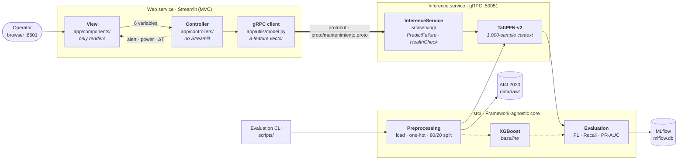

<div align="center">

# Predictive Maintenance with TabPFN-v2

**Estimating the probability of failure of industrial machinery from its operating variables**

[](https://www.python.org/)
[](https://docs.astral.sh/uv/)
[](https://streamlit.io/)
[](https://www.docker.com/)
[](https://mlflow.org/)
[](https://grpc.io/)
[](https://gitlab.com/dfgarces13/ProyectoDDPIA_MantenimientoPredictivoIA/-/pipelines)

[](#testing-and-quality)
[](https://docs.astral.sh/ruff/)
[](.specify/memory/constitution.md)
[](LICENSE)

*[Leer en español](README.es.md)*

</div>

> **English summary**
>
> End-to-end predictive maintenance system that estimates the probability of failure of an industrial machine from its operating variables, such as torque, rotational speed, air and process temperature and tool wear. Since failures account for only 3.4% of the AI4I 2020 dataset, models are compared on the failure class, where the pretrained TabPFN-v2 transformer outperformed an XGBoost baseline on every metric: F1 0.825 versus 0.729, recall 0.765 versus 0.750 and PR-AUC 0.880 versus 0.837.
>
> The system runs as two Docker services connected through gRPC, an inference server and a Streamlit interface built on the MVC pattern, and it is backed by MLflow experiment tracking, 169 automated tests and a GitLab CI/CD pipeline that tests, builds and deploys to a cloud server.
>
> **My role:** As project lead of a four-person team, I defined the modeling approach and divided the work into pull requests that I reviewed and merged, while also contributing fixes to the gRPC client, the split between unit and integration tests for the CI runner and the team's MCP configuration.

<p align="center">
  
  
</p>


---

## Table of contents

- [Context](#context)
- [Architecture](#architecture)
- [Project structure](#project-structure)
- [Tech stack](#tech-stack)
- [Installation](#installation)
- [Usage](#usage)
- [Running with Docker](#running-with-docker)
- [Testing and quality](#testing-and-quality)
- [CI/CD and deployment](#cicd-and-deployment)
- [Results](#results)
- [Exploratory analysis](#exploratory-data-analysis-eda)
- [Specification-driven development](#specification-driven-development)
- [Project status](#project-status)
- [Team](#team)
- [License](#license)

---

## Context

### The problem

In an industrial plant, an unplanned stop costs much more than preventive maintenance. The challenge is to anticipate the failure: to decide, from a machine's current readings, whether it is worth intervening **before** it stops.

This project frames that decision as a **binary classification** problem. From six variables (product type, air temperature, process temperature, rotational speed, torque and tool wear) the system returns the probability of failure and turns it into a three-level operational traffic light.

### The data

The project uses the [AI4I 2020 Predictive Maintenance](https://archive.ics.uci.edu/dataset/601/ai4i+2020+predictive+maintenance+dataset) dataset (UCI, CC BY 4.0): 10,000 records, 14 columns, no missing values.

The defining fact is its **severe imbalance: only 339 records (3.39%) are failures**. That shapes everything else, starting with the choice of metrics: a model that never raised an alert would be right 96.6% of the time while being completely useless.

### The approach

The base model is **TabPFN-v2**, a transformer pretrained for tabular data that predicts *in context*: it receives the reference set as part of the call and returns probabilities, **with no gradient training or hyperparameter search**. As a classic reference, it is compared against an **XGBoost** model trained from scratch, with the imbalance offset through `scale_pos_weight`.

The solution is split into two services that communicate through **gRPC**: `inference` loads TabPFN-v2 and exposes the prediction over the network, and `web` is a **Streamlit** interface organized according to the MVC pattern that acts as a lightweight client of that service. Both are packaged with **Docker Compose** and deployed with a **GitLab CI/CD** pipeline to a DigitalOcean server.

---

## Architecture

> 📐 **[Interactive diagram →](docs/arquitectura.html)** of the monolithic version prior to gRPC, explorable and exportable to PNG/SVG. Download it and open it in the browser; GitHub does not render HTML inline.



### How responsibilities are divided

| Layer | Location | Responsibility |
|---|---|---|
| **View** | `app/components/` | Only renders. It receives already resolved values; it does not call domain functions or compute anything. |
| **Controller** | `app/controllers/` | Coordinates: form → vector → inference → values for the view. It does not import Streamlit, which is why it can be tested without launching the interface. |
| **Model (app)** | `app/utils/` | Interface domain: physics, alert thresholds, vector construction and the gRPC client of the inference service. |
| **Inference service** | `src/serving/` | Loads TabPFN-v2 only once and exposes `PredictFailure` and `HealthCheck` over gRPC. It validates the input and responds with `INVALID_ARGUMENT` to a malformed vector. |
| **Contract** | `proto/` | Protobuf definition shared by client and server, with its generated stubs (`make proto`). |
| **Model (core)** | `src/` | Dataset loading and validation, preprocessing, models and evaluation. It does not know Streamlit exists. |

### Decisions behind the design

- **A single source of truth for feature order.** `app/utils/preprocessing.NOMBRE_FEATURES` is derived from `src.preprocessing.preprocess` instead of repeating the list. A test processes the same row through both paths and fails if they diverge.
- **The alert threshold is applied when rendering, not when predicting.** Moving the slider recalculates the traffic light on the same probability, without repeating an inference that takes 1-2 s on CPU.
- **The contract between layers is tested.** A test uses `inspect.signature` to compare the keys produced by the controller against the parameters declared by the view.
- **The heavy model lives outside the interface.** Streamlit does not import torch or tabpfn: it only opens a gRPC channel. The interface starts in seconds, shows whether the service is connected and, if it is not, fails with an explicit message instead of hanging.
- **The controller receives inference by injection.** In the app it is the gRPC client and in the tests a double, which is why the coordination is tested without network or model.
- **TabPFN is not trained.** It uses `fit_context()`, which only registers the reference set. The interface fixes 1,000 stratified samples to keep latency low.

---

## Project structure

```text
.
├── app/                      # Streamlit interface (MVC pattern)
│   ├── components/           #   View: form, results, settings
│   ├── controllers/          #   Controller: prediction coordination
│   ├── utils/                #   App model: physics, preprocessing, gRPC client
│   └── main.py               #   Streamlit entrypoint
├── src/                      # Framework-agnostic core
│   ├── preprocessing/        #   Loading, one-hot of Type, stratified split
│   ├── models/               #   TabPFN-v2 and XGBoost baseline
│   ├── serving/              #   gRPC inference service
│   └── evaluation/           #   Failure-class metrics and MLflow tracking
├── proto/                    # gRPC contract (.proto) and generated stubs
├── tests/
│   ├── unit/                 #   Unit tests
│   └── integration/          #   End-to-end tests
├── EDA/                      # Exploratory analysis: script, tables, figures, report
├── scripts/                  # Executable entrypoints
├── specs/                    # Spec-kit specifications per increment
├── docs/                     # Interactive architecture diagram
├── data/raw/                 # AI4I 2020 dataset (not versioned)
├── .specify/memory/          # Project constitution
├── Dockerfile                # Multi-stage: `web` and `inference` images
├── docker-compose.yml        # Orchestrates both services on the Linux server
├── docker-compose.local.yml  # Variant for Docker Desktop (bridge network)
├── .gitlab-ci.yml            # Pipeline test → build → deploy
├── Makefile                  # Development shortcuts (`make help`)
├── LICENSE                   # MIT, plus third-party terms
└── pyproject.toml            # Dependencies and Ruff/pytest configuration
```

---

## Tech stack

| Component | Tool |
|---|---|
| Base model | TabPFN-v2 (`tabpfn>=8.5.0`) |
| Classic baseline | XGBoost (`xgboost>=3.2.0`) |
| Dataset | AI4I 2020 Predictive Maintenance (UCI) |
| Processing | pandas · NumPy · scikit-learn |
| Visualization | matplotlib |
| Interface | Streamlit |
| Communication between services | gRPC · Protocol Buffers |
| Container | Docker multi-stage (`python:3.12-slim` + uv 0.12.3) · Docker Compose |
| CI/CD | GitLab CI/CD with a self-hosted runner on DigitalOcean |
| Environment management | uv |
| Testing | pytest · pytest-cov |
| Quality | Ruff (lint + format) · pre-commit |
| Experiment tracking | MLflow (SQLite backend) |

> **About the baselines.** GradientBoosting was ruled out: XGBoost already plays the role of classic reference, and adding a second model from the same family would not provide new evidence.

---

## Installation

**Requirements:** [uv](https://docs.astral.sh/uv/) and Python 3.12.

```bash
# 1. Clone the repository
git clone https://github.com/julicapa15/predictive-maintenance-tabpfn.git
cd predictive-maintenance-tabpfn

# 2. Create the environment and install the exact dependencies from uv.lock
uv sync
```

There is no need to activate the environment: every command is prefixed with `uv run`.

To add dependencies, always use `uv add <package>` (or `uv add --dev <package>`), never `pip install`.

### Dataset

The CSV is not versioned. Download [AI4I 2020](https://archive.ics.uci.edu/dataset/601/ai4i+2020+predictive+maintenance+dataset) and place it at:

```text
data/raw/ai4i2020.csv
```

Loading validates that it has exactly 10,000 rows, the 14 original columns and no nulls. If something does not match, it fails with an explicit message instead of moving forward with questionable data.

### TabPFN-v2 license

TabPFN downloads its weights after a one-time license acceptance at [ux.priorlabs.ai](https://ux.priorlabs.ai). Without it, its tests are skipped automatically instead of failing.

> **On Windows** the interactive flow fails with `OSError: [WinError 10038]`: the library uses `select()` on `stdin`, which on Windows only supports sockets. Generate an API key at [ux.priorlabs.ai/account](https://ux.priorlabs.ai/account) and export it before running:
>
> ```powershell
> $env:TABPFN_TOKEN = "your_api_key"
> ```

### If the repository lives in OneDrive

OneDrive does not support hard links and `uv` may fail with `os error 396`. It is solved once:

```powershell
setx UV_LINK_MODE copy
```

---

## Usage

### Web interface

The app is made of two processes that talk to each other over gRPC. In two terminals:

```bash
uv run python -m src.serving.server     # terminal 1, inference service (or: make grpc-server)
uv run streamlit run app/main.py        # terminal 2, web interface (or: make app)
```

Available at `http://localhost:8501`. Enter the six variables, press **Predecir falla** and you get:

- a three-level **traffic light** (Normal / Precaución / Falla inminente),
- the failure **probability**,
- the **mechanical power** and the **ΔT** derived from the readings,
- the 8-feature vector the model actually received.

The side slider adjusts the alert sensitivity between 35% and 90%: a more sensitive setting detects failures at a lower probability at the cost of more false alarms.

### Model evaluation

```bash
uv run python -m scripts.evaluar_modelos                 # or: make evaluar
uv run python -m scripts.evaluar_modelos --sin-tabpfn    # baseline only
```

It runs the full pipeline, prints the comparison and logs both runs to MLflow. It accepts `--spec-id` and `--experimento` to associate the runs with the right feature.

### MLflow interface

```bash
uv run mlflow ui --backend-store-uri sqlite:///mlflow.db --port 5000   # or: make mlflow
```

### Exploratory analysis

```bash
uv run python EDA/eda.py
```

It generates four tables in `EDA/` and five figures in `EDA/figures/`.

### Available shortcuts

`make help` lists all of them. The most used:

| Command | What it does |
|---|---|
| `make grpc-server` | Launches the gRPC inference service |
| `make app` | Launches the Streamlit interface |
| `make test` | Runs the 169 tests |
| `make coverage` | Tests with a coverage report |
| `make check` | Lint + format check |
| `make evaluar` | Evaluates both models and logs them to MLflow |
| `make compose-up` / `make compose-up-local` | Brings up both services with Docker Compose |
| `make proto` | Regenerates the gRPC stubs |

---

## Running with Docker

The `Dockerfile` is multi-stage and produces two images that share the dependency stage: `inference`, with TabPFN-v2 on port 50051, and `web`, with Streamlit on 8501. Dependencies are installed in a layer separate from the code, the containers run as an unprivileged user and the `uv` version is pinned so that two builds of the same commit are identical.

The dataset **is not baked into the image**: it is mounted as a volume in `inference`, just as in local development.

```bash
cp .env.example .env            # and fill in TABPFN_TOKEN
docker compose up --build       # or: make compose-up
```

`docker-compose.yml` uses `network_mode: host`, intended for the Linux deployment server. On Docker Desktop (Windows or macOS) use the variant with a bridge network, which also waits for `inference` to be healthy before bringing up `web`:

```bash
docker compose -f docker-compose.local.yml up --build   # or: make compose-up-local
```

---

## Testing and quality

```bash
uv run pytest                                               # 169 tests
uv run pytest tests/unit/ -v                                # unit tests only, without network or TabPFN
uv run pytest --cov=src --cov=app --cov-report=term-missing # with coverage
uv run ruff check . && uv run ruff format --check .         # lint and format
uv run pre-commit run --all-files                           # all hooks
```

The tests that load TabPFN live in `tests/integration/`, because they need to download the weights and a fair amount of RAM. The unit tests run without network, which is what the CI pipeline executes.

### Verified conventions

- **Mandatory AAA structure.** Every test is written in three blocks separated by a blank line, headed by the literal comments `# 1. ARRANGE (...)`, `# 2. ACT (...)` and `# 3. ASSERT (...)` with their description. No exceptions: tests that check errors capture the exception with `as excinfo` and assert on its message in the ASSERT block.

  ```python
  def test_archivo_inexistente_lanza_error(tmp_path):
      # 1. ARRANGE (Ruta a un archivo que no existe)
      ruta = tmp_path / "no_existe.csv"

      # 2. ACT (Intentar cargar un archivo que no está en disco)
      with pytest.raises(FileNotFoundError) as excinfo:
          load_raw_data(ruta)

      # 3. ASSERT (El mensaje nombra la ruta que falta)
      assert "no_existe.csv" in str(excinfo.value)
  ```

- **Mandatory Google docstrings.** Every public function, method and class documents `Args:`, `Returns:` and `Raises:`. Ruff enforces it (`select = ["D"]`, `convention = "google"`): the build fails if a section is missing.
- **Pre-commit** runs Ruff on every commit, plus TOML/YAML validation and whitespace cleanup.

---

## CI/CD and deployment

The pipeline runs in the [team's GitLab repository](https://gitlab.com/dfgarces13/ProyectoDDPIA_MantenimientoPredictivoIA) with a self-hosted runner installed on a DigitalOcean server. This GitHub repository keeps the same code, but `.gitlab-ci.yml` only runs there.

| Stage | What it does |
|---|---|
| `test` | Ruff (lint and format) and the unit tests |
| `build` | Builds the `web` and `inference` images with Docker Compose |
| `deploy` | Only on `master`: downloads the dataset if missing, writes the TabPFN token from a protected variable and restarts the containers |

The [`.mcp.json`](.mcp.json) file configures the [official GitLab MCP server](https://docs.gitlab.com/user/model_context_protocol/mcp_server/) so the team can review issues, merge requests and pipeline logs from the editor with any MCP client. It uses OAuth, so it stores no secrets: each member authenticates with their own account.

---

## Results

Binary classification of `Machine failure`. Stratified 80/20 split with `random_state=42`; metrics measured on the 2,000 test records (68 actual failures), always on the failure class.

| Model | F1 | Recall | PR-AUC |
|---|:---:|:---:|:---:|
| **TabPFN-v2** | **0.825** | **0.765** | **0.880** |
| XGBoost | 0.729 | 0.750 | 0.837 |

**TabPFN-v2 beats the baseline on all three metrics**, with no gradient training and no hyperparameter tuning: only in-context learning. XGBoost competes closely on recall (0.750 versus 0.765) after offsetting the imbalance with `scale_pos_weight = 28.52`.

> **Why accuracy is not used as a success criterion.** With 3.39% failures, a model that never raised an alert would reach 96.6% accuracy while being useless. The project decides with F1, Recall and PR-AUC on the failure class. Accuracy is computed and logged to MLflow only as a contrast figure that makes that problem visible.

Each run is logged with the `spec_id` tag of its feature, the model's license and repository, the dataset hash, the execution environment, the inference latency, sample predictions, an evaluation report and the model packaged in its native format.

---

## Exploratory data analysis (EDA)

Full report with tables and figures in **[EDA/informe_eda.md](EDA/informe_eda.md)**.

Findings that shape the modeling:

- **Severe imbalance:** 339 failures out of 10,000 records (3.39%), which rules out *accuracy* and justifies F1, Recall and PR-AUC.
- **Uneven failure modes:** HDF (115), OSF (98) and PWF (95) account for most cases; TWF (46) and RNF (19) are marginal.
- **Torque and tool wear are the most discriminating variables:** in records with a failure, mean torque rises from 39.6 to 50.2 Nm and tool wear from 106.7 to 143.8 min, while speed drops from 1,540 to 1,496 rpm.
- **Two nearly collinear pairs:** the two temperatures (r = 0.88) and speed with torque (r = −0.88). TabPFN-v2 handles this internally, without manual feature selection.
- **RNF is noise by definition:** it should not be predictable from the process variables, which is worth keeping in mind when interpreting performance by failure mode.

---

## Specification-driven development

The project is governed by a **constitution** ([`.specify/memory/constitution.md`](.specify/memory/constitution.md), v1.2.2) with six non-negotiable principles: TabPFN without gradient training, failure-class metrics, minimal and replaceable preprocessing, CRISP-DM as the phase framework, AAA structure in tests and Google docstrings.

Each increment is organized as a spec-kit feature with its `spec.md` (what and why), `plan.md` (how) and `tasks.md` (ordered tasks):

| Feature | Scope | Status |
|---|---|:---:|
| [`001-tabpfn-xgboost-baseline`](specs/001-tabpfn-xgboost-baseline/) | TabPFN-v2 pipeline + XGBoost baseline + MLflow | ✅ |
| [`002-eda-preprocesamiento`](specs/002-eda-preprocesamiento/) | Exploratory analysis of the dataset | ✅ |
| [`003-interfaz-streamlit`](specs/003-interfaz-streamlit/) | Web interface and MVC architecture | ✅ |

Deviations from the plan are documented in the spec itself instead of being silently corrected. Spec 002, for example, includes a traceability section explaining why it was closed covering only the EDA.

### Workflow

`main` is protected and contains only the initial structure commit; **`develop` is the integration branch**. Work happens in feature branches and enters through Pull Requests against `develop`, with messages in the `type: short description` format (`feat`, `fix`, `chore`, `docs`, `test`, `refactor`).

---

## Project status

| Phase | Status |
|---|:---:|
| Repository structure | ✅ |
| Dataset loading and exploration | ✅ |
| Preprocessing and stratified split | ✅ |
| TabPFN-v2 base model | ✅ |
| XGBoost baseline | ✅ |
| Evaluation, metrics and MLflow tracking | ✅ |
| Streamlit interface (MVC) | ✅ |
| gRPC inference service | ✅ |
| Containerization with Docker Compose | ✅ |
| Living architecture documentation | ✅ |
| CI/CD and deployment on GitLab | ✅ |

---

## Team

**Universidad Autónoma de Occidente**, AI Project Development

| Member |
|---|
| Juliana Campuzano |
| Diego Fernando Garcés |
| Jorge Iván Gonzáles |
| Juan José Mosquera |

---

## License

The code of this project is distributed under the **MIT** license; see [LICENSE](LICENSE).

Third-party components keep their own terms: **TabPFN-v2** under the Prior Labs license (non-commercial / academic use), **XGBoost** under Apache-2.0 and the **AI4I 2020 dataset** under CC BY 4.0.
